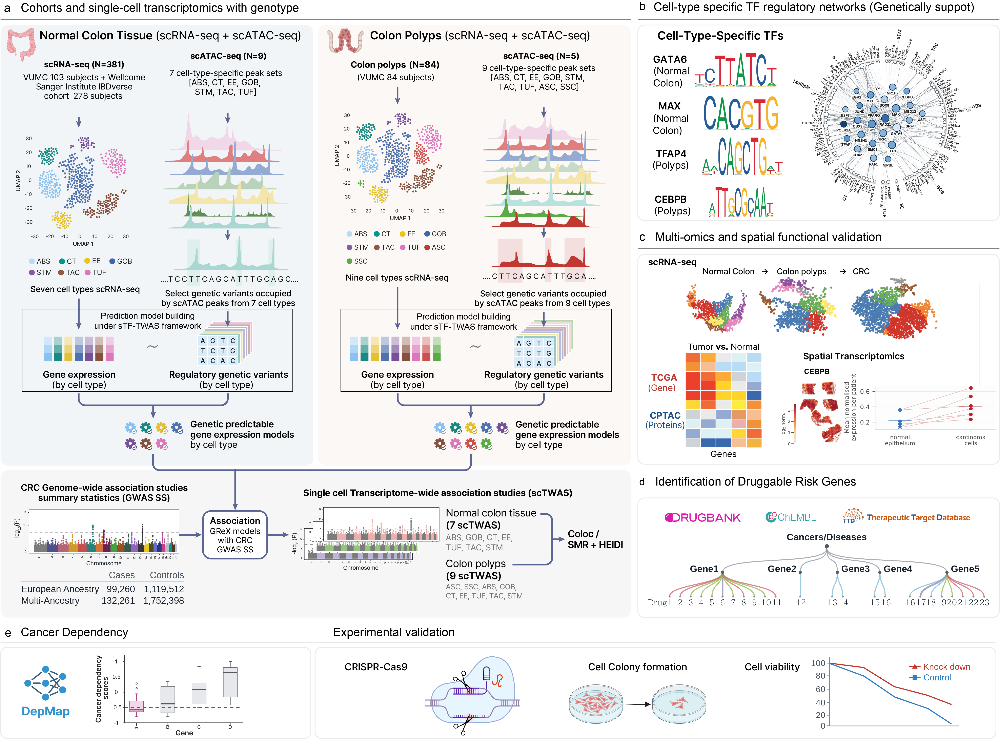

# Single-cell transcriptome-wide association analysis reveals epithelial cell-specific genetic susceptibility to colorectal cancer

The study uses single-cell transcriptome-wide association analysis (scTWAS) to investigate
how inherited colorectal cancer (CRC) risk relates to gene regulation in normal and
premalignant epithelium. It combines matched germline genotypes and single-cell transcriptomes
from normal colorectal mucosa (381 donors) and polyps (84 donors), using cell-type-specific
chromatin accessibility to select variants for genetically regulated expression (GReX) models.
Integration with European-ancestry and multi-ancestry CRC genome-wide association study
(GWAS) results identified 546 gene–cell-type associations implicating 347 candidate
susceptibility genes across seven normal and nine polyp epithelial populations.

Follow-up analyses assessed shared genetic signals through colocalization and SMR–HEIDI
and mapped cell-type-specific transcription factor networks using co-expression and
ChIP-seq evidence. Multi-omics analyses supported dysregulation of 233 candidate genes.
Drug-target annotation identified 63 potentially druggable genes, and the combined
DepMap and CRISPR–Cas9 analyses implicated 35 genes in CRC cell viability.

## Study overview

[](Figure1.png)

**Figure 1. Study design and analytical framework.** Panel a follows the workflow from
single-cell data and chromatin-based variant selection through expression model training,
scTWAS, and genetic follow-up. Panels b–e show transcription factor networks, multi-omics
and spatial support, drug-target annotation, and cancer dependency and experimental tests.

## Layout

```
code/          Analysis scripts, figure renderers and shared helpers
env/           Python dependencies, R lockfiles and external tools
res/           Project resources
MANIFEST.csv   File inventory with sizes and MD5 checksums
```

## Reproducing the analysis

1. Set up the Python and R environments and [external tools](env/external_tools.md).
2. Obtain the cohort data, chromatin peak sets, trained GReX models and GWAS summary statistics listed in the manuscript's Data availability statement. Set the local input and output paths in each section.
3. Use the section READMEs for commands. Section 10 starts from the CRC GWAS lead-variant list and cohort inputs. Section 11 can render figures from archived source values.

## Analysis workflow

| Section | Main inputs, outputs and downstream use |
|---|---|
| [01 Single-cell and xQTL](code/01_single_cell_and_xqtl) | Prepares matched pseudobulk expression and genotypes for sections 03 and 10. PEER residualization and tensorQTL provide cis-eQTL statistics for sections 05 and 10. |
| [02 Accessible chromatin](code/02_accessible_chromatin) | Calls and merges cell-type scATAC-seq peaks. The peak variant lists define candidate predictors for section 03. |
| [03 GReX model training](code/03_grex_model_training) | Trains elastic-net models from sections 01 and 02. PredictDB weights and covariances feed section 04, and model variants feed section 06. |
| [04 Association testing](code/04_association_testing) | Runs S-PrediXcan against CRC GWAS statistics and combines normal-colon results across cohorts with ACAT. Significant gene–cell-type pairs feed sections 05–07. |
| [05 Colocalization and SMR–HEIDI](code/05_colocalization_smr_heidi) | Tests significant TWAS gene–cell-type pairs against source-matched cis-eQTL statistics. |
| [06 TF networks](code/06_tf_network) | Uses prioritized genes, pseudobulk expression and model variants to evaluate TF–target co-expression and lead-variant occupancy. |
| [07 Orthogonal support](code/07_orthogonal_support) | Harmonizes prioritized genes and evaluates expression support in single-cell and pseudobulk data, TCGA, CPTAC, GeoMx and CosMx. The evidence informs section 08. |
| [08 Druggability and connectivity](code/08_druggability_and_connectivity) | Annotates drug–target relationships, runs Enrichr on the druggable-gene list, and scores compounds with iLINCS. The section README identifies the archived KEGG export used for Supplementary Table 23. |
| [09 Functional screens](code/09_functional_screens) | Analyzes archived DepMap Chronos scores and arrayed CRISPR-Cas9 viability data for Figure 7 and Supplementary Tables 25–26. |
| [10 GWAS lead-variant follow-up](code/10_GWAS_leadvar_coloc_SMR) | Tests 275 GWAS lead variants for association with cell-type expression and follows up significant cis pairs with coloc and SMR–HEIDI for Supplementary Tables 12–13. |
| [11 Figures](code/11_figures) | Uses archived TF, multi-omics, drug and screen results to draw manuscript panels. The section README maps Figures 2–7 and Extended Data Figures 1 and 4–9 to their renderers and source values. |

## Archive inputs

- Section 10 documents the archived coloc and SMR–HEIDI merge script and the inclusion difference for Supplementary Table 13.
- The DepMap rerun starts from archived scores and gene sets. The original Open Targets retrieval and gene-set construction are external to that rerun.
- The [figure README](code/11_figures/README.md) identifies the source workbook and the archived Illustrator layouts for Figures 4 and 5.

## Citation

See [`CITATION.cff`](CITATION.cff) for citation details.

Released under the terms in [`LICENSE`](LICENSE).

## Contact

Qing Li -- liqingbioinfo@gmail.com \
Xingyi Guo -- xingyi.guo@vumc.org
